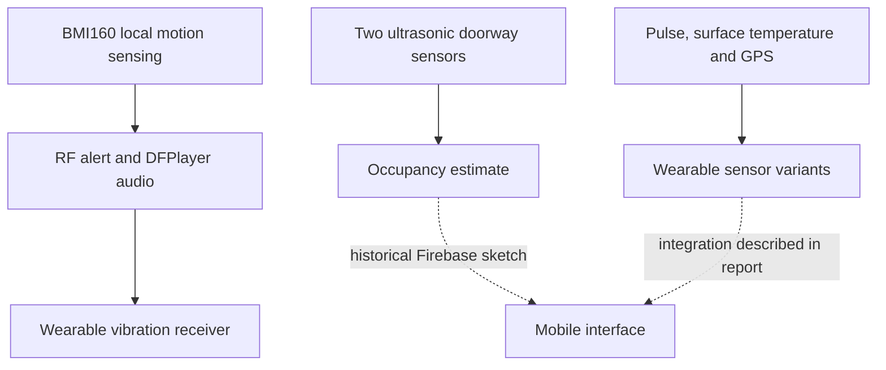

# Architecture and implementation boundaries

Solid links describe functions found in source sketches. Dashed links indicate historical cloud code or report-level integration; a full gateway and deployable mobile source are not included. The RF modules do not themselves provide internet connectivity.

## Engineering functions

1. A BMI160 measures acceleration at the installation point. The historical alarm uses an acceleration threshold. This is a local motion trigger, not a forecast and not a networked seismic early-warning service.
2. The alarm source transmits a short state message and plays recorded audio. Wearable variants receive an alert and activate vibration.
3. Wearable sensing variants read an optical pulse signal, an infrared thermometer and GPS. Sensor values require calibration, validity checks and environmental testing before any health interpretation.
4. Two spaced ultrasonic detectors estimate passage direction from detection order. This is a doorway estimate; it does not locate people under debris or count multiple side-by-side users reliably.
5. App Inventor screens illustrate preparedness and monitoring interfaces. The repository does not reconstruct the missing mobile source from screenshots.

## 2026 maintenance logic

`firmware/logic/` contains independently testable C++ components for timed doorway sequences, beat intervals and three consecutive motion samples. These are maintenance components, not a claim that the 2025 devices used this exact implementation. No maintained hardware wrapper, internet service, or new field validation is implied.
